  <!-- 1. HERO MATRIX RAIN & IDENTITY -->
  

   

  <!-- 2. BIO & IDENTITY DESCRIPTION -->
  

    <strong>Full-stack Developer</strong> 
    Passionate about building high-performance, maintainable, and well-architectured software systems.
  

   

  <!-- 3. MATRIX COMMAND PROMPT TYPING -->
  

    

  <!-- 4. MONOCHROME MATRIX BADGES -->
  
  &nbsp;
  
  &nbsp;
  
  &nbsp;
  

    

  

 

## WHO AM I ?

> *"Passionate about building high-performance, maintainable, and well-architectured software systems."*

Hey, I'm **Julian Hoang** (`nhocbinhbo99`) &mdash; a **Full-stack Developer** focused on crafting responsive web applications and clean, modular backend architectures.

* **Full-Stack Web Engineering:** Building interactive, modern web interfaces with **React 19**, **React Router v7**, and **Tailwind CSS v4**, backed by **Node.js (Express)**, **MongoDB**, **Google OAuth 2.0**, and **JWT** authentication.
* **System Re-architecture & Java Backend:** Experienced in refactoring legacy monolithic codebases into clean **Maven Multi-module** architectures (`common`, `server`, `client`) with strict separation of concerns and **JPA/Hibernate ORM** optimization.
* **End-to-End Product Delivery:** From real-time interactive seating maps and **MoMo Sandbox** payment flows to inventory, billing, and real-time sales reporting modules.

 

## ACTIVE PROCESSES

<table>
  <tr>
    <td width="50%" valign="top">
      <!-- Add GitHub repo URL to href="" below when ready -->
      
<strong><a href="">TICKETFLIX</a></strong> &nbsp; <code>[PID: 0x01 // WEB]</code> &bull; <a href="https://ticketflix.me"><strong>Live Demo</strong></a>

      
Online Movie Ticket Booking System (Personal Project)

      

        Intuitive movie ticket booking platform featuring a dynamic, real-time seating map
        (Standard, VIP, Double), <strong>MoMo Sandbox</strong> payment integration, quick login via
        <strong>Google OAuth 2.0</strong> with <strong>JWT</strong> security, and mouse-interactive dynamic light ray effects.
      

      

        
        
        
        
        
        
      

    </td>
    <td width="50%" valign="top">
      <!-- Add GitHub repo URL to href="" below when ready -->
      
<strong><a href="">PHARMACY MANAGEMENT SYSTEM</a></strong> &nbsp; <code>[PID: 0x02 // JAVA]</code>

      
System Re-architecture (Group Project &mdash; Backend / Java Developer)

      

        Restructured a legacy monolithic pharmacy system into a modern <strong>Maven Multi-module</strong>
        architecture (<code>common</code>, <code>server</code>, <code>client</code>) with strict separation of concerns.
        Optimized persistence with <strong>JPA/Hibernate ORM</strong> and built core modules for medication
        management, billing/invoicing, inventory control, and real-time sales reporting.
      

      

        
        
        
        
        
      

    </td>
  </tr>
</table>

## LOADED MODULES

<table width="100%">
  <tr>
    <td width="18%" valign="middle"><strong>LANGUAGES</strong></td>
    <td width="82%" valign="middle">
      
      
      
      
      
    </td>
  </tr>
  <tr>
    <td width="18%" valign="middle"><strong>FRONTEND</strong></td>
    <td width="82%" valign="middle">
      
      
      
      
    </td>
  </tr>
  <tr>
    <td width="18%" valign="middle"><strong>BACKEND</strong></td>
    <td width="82%" valign="middle">
      
      
      
      
    </td>
  </tr>
  <tr>
    <td width="18%" valign="middle"><strong>DATABASE &amp; AUTH</strong></td>
    <td width="82%" valign="middle">
      
      
      
      
      
    </td>
  </tr>
  <tr>
    <td width="18%" valign="middle"><strong>TOOLS &amp; DESIGN</strong></td>
    <td width="82%" valign="middle">
      
      
      
      
       
      
    </td>
  </tr>
</table>

 

  
  &nbsp;
  

    

